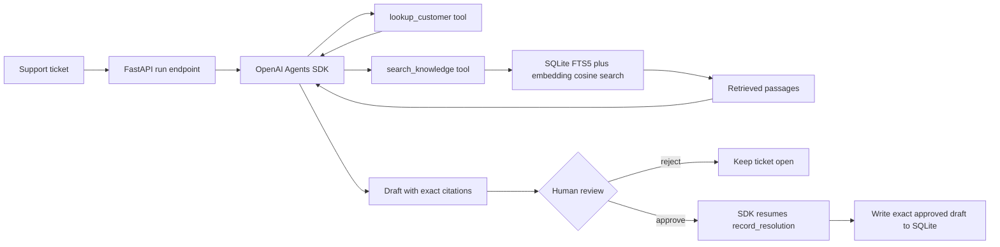
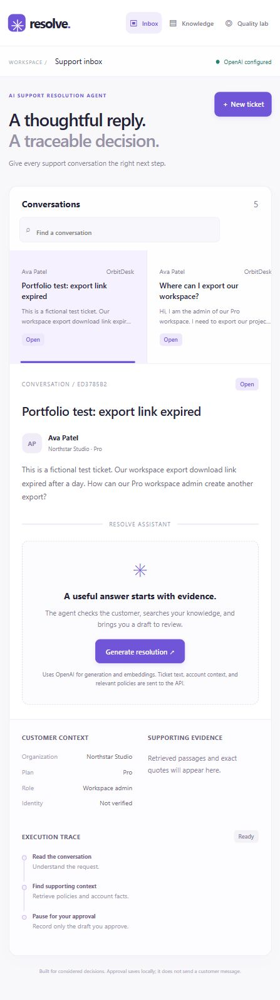

# Resolve — AI Support Resolution Agent

Resolve is a fully GenAI support-agent workbench. It reads a support ticket, retrieves policy passages using embeddings and keyword search, calls scoped tools, drafts a cited customer reply, and pauses before it records a resolution. The user decides whether to approve or reject the exact draft.

It intentionally does **not** include dashboards, data analysis, or business intelligence. This is a separate portfolio project focused on LLM orchestration, RAG, tool use, grounding, human-in-the-loop approval, and evaluation.

## What makes it interview-ready

- One OpenAI Agents SDK agent calls deterministic customer lookup and RAG tools before drafting.
- Hybrid RAG chunks policies, creates OpenAI embedding vectors, combines them with SQLite FTS5 keyword search, and uses reciprocal-rank fusion.
- The backend rejects a citation whose quote is not an exact substring of a retrieved passage.
- `record_resolution` is an SDK tool marked `needs_approval=True`; serialized run state remains server-side, and approval rechecks exact tool arguments before writing locally.
- Deterministic tests cover attempted evidence bypass, invalid citations, escalation rules, restart-safe approval, and duplicate review protection. They do not establish live model resistance to prompt injection.
- A small synthetic evaluation harness checks sources, tools, citations, and expected escalation behavior.

## Architecture



## How RAG works here

1. A policy is split into roughly 1,100-character passages with 180-character overlap.
2. The title plus each passage is sent to `text-embedding-3-small`. An embedding is a vector representing semantic features of the text; it lets “how long is the export link valid?” match “download link expires after 24 hours.”
3. Vectors and metadata are stored in SQLite. SQLite FTS5 stores the same text for exact keyword matching.
4. The query also becomes an embedding. The app ranks cosine similarity and FTS5 results, then fuses rankings with reciprocal-rank fusion.
5. The agent receives only the top passages. A citation must name a returned passage and quote it exactly; the backend checks this before human review.

Embeddings are for retrieval only. The model writes a reply, but cannot record a resolution until a person approves it.

## Run locally

Requires Python 3.12+.

Open this project folder in VS Code and select `.venv/Scripts/python.exe` as the Python interpreter. The included F5 configuration starts FastAPI on port 8010. If Resolve is already running, use the existing browser session or stop its earlier terminal process before starting another.

```powershell
git clone https://github.com/sasthika-17/resolve-ai-support-agent.git
cd resolve-ai-support-agent
.\setup.ps1
.\.venv\Scripts\python.exe run.py
```

Open [http://127.0.0.1:8010](http://127.0.0.1:8010). FastAPI docs are at [http://127.0.0.1:8010/docs](http://127.0.0.1:8010/docs). The credential belongs in ignored `.env.local`, never in Git.

Follow [the learning guide](docs/LEARNING_GUIDE.md) one exercise at a time. It maps the important functions to their purpose and starts with a small browser → FastAPI → SQLite exercise that needs no API credits.

## Demo path

1. Open **Where can I export our workspace?**
2. Select **Generate resolution**. The first run indexes the synthetic policy documents, so it makes embedding and model requests.
3. Read the draft, open its source chips, and inspect the execution trace.
4. Select **Approve & save** to record the exact reviewed draft locally, or **Reject draft** to keep the ticket open.
5. Open **Quality lab** and compare hybrid, semantic, and keyword retrieval.

Approval does not send an email, alter an account, issue a refund, or take any action outside local SQLite. The mock product, policies, tickets, and customers are synthetic.

## API

All write endpoints require `X-Resolve-Request: 1`; browser-origin checks reject cross-origin writes. Errors use `{"error":{"code":"...","message":"..."}}`.

| Endpoint | Purpose |
|---|---|
| `GET /api/health` | Readiness, model names, and index counts without exposing the key |
| `GET/POST /api/tickets` | List or add synthetic tickets |
| `POST /api/tickets/{id}/runs` | Start an agent run; returns 202 while it works |
| `GET /api/runs/{id}` | Inspect draft, sources, trace, status, and safe usage counts |
| `POST /api/runs/{id}/review` | Approve or reject a pending exact tool call |
| `GET /api/runs/{id}/export` | Download the draft, citations, usage, and trace without the SDK snapshot |
| `GET/POST /api/documents` | Read or add knowledge sources |
| `POST /api/documents/upload` | Import bounded UTF-8 Markdown or plain text |
| `POST /api/knowledge/index` | Create missing embeddings |
| `POST /api/knowledge/search` | Inspect hybrid, semantic, or keyword retrieval |
| `GET /api/evaluations` | Read the latest opt-in behavior report if one exists |

HTTP 202 means generation is running; poll the returned run ID. A provider failure changes that run to `failed` with a safe `error` and `error_code`. Request errors use HTTP 422 for invalid fields, 404 for unknown records, 409 for state conflicts, and 503 for unavailable provider access. In Swagger, enter `1` in the `x-resolve-request` header field for write requests. That header is not user authentication.

## Tests and evaluation

```powershell
.\.venv\Scripts\python.exe -m pytest -q
.\.venv\Scripts\python.exe -m pip check
```

The deterministic suite uses the Agents SDK `ScriptedModel` for the pause → approve/reject → resume contract and a stable local embedder for RAG behavior. It makes no paid requests.

These make paid OpenAI requests:

```powershell
.\.venv\Scripts\python.exe scripts\verify_live.py
.\.venv\Scripts\python.exe evals\run_live.py --run
```

The live evaluation report appears in **Quality lab**, with pass/fail checks distinguished from provider errors and skipped cases. The expected policy must be cited, not merely retrieved. Each invocation uses isolated synthetic state and rejects its drafts. A provider failure stops additional cases from making redundant requests. This four-case suite is not a production accuracy claim.

`openai-agents` is pinned to the tested SDK version because this project persists SDK run state. `requirements-lock.txt` records the verified Windows environment; cross-platform CI installs `requirements.txt`. Changing the SDK can invalidate a pending snapshot; obsolete drafts can be rejected and regenerated.

## Current verification status

- 24 deterministic tests passed on 9 October 2026.
- Dependency integrity check passed.
- A real embedding request reached OpenAI and returned HTTP 429 with `code=credit_balance_exhausted` and `type=insufficient_quota`. API credits are exhausted; this requires a billing change. Live embeddings and generation remain unverified.
- No resolution was written during the failed live verification.

To unblock live requests, check [OpenAI API billing](https://platform.openai.com/settings/organization/billing). [OpenAI's error guidance](https://help.openai.com/en/articles/6614457-troubleshooting-api-usage-and-spend-limits) distinguishes credit exhaustion from temporary rate limits. The saved credential does not need to be recreated for this error.

## Project map

```text
app/        Agent instructions, RAG, SQLite persistence, FastAPI API
frontend/   Responsive browser workbench
data/       Synthetic customers, tickets, and support policies
tests/      Retrieval, store, approval, and grounding tests
evals/      Live behavior cases and opt-in runner
docs/       Build brief, interview preparation, verification record
.vscode/    Interpreter, recommended extensions, F5 launch configuration
.github/    Deterministic test workflow; no paid API calls
```

## Resume bullets — use only after you can demo it

- Built **Resolve**, a tool-using AI support agent with OpenAI Agents SDK, hybrid RAG, structured citations, and server-side human approval before durable resolution writes.
- Implemented hybrid retrieval over policy documents using OpenAI embeddings, SQLite FTS5, cosine similarity, and reciprocal-rank fusion; added source-quote validation to reject unsupported drafts.
- Added 24 deterministic tests covering retrieval, provider error classification, API contracts, evidence bypass rejection, citation validation, and durable approval/rejection behavior.

Do not claim live accuracy, production deployment, customer impact, or quality percentages unless you have measured evidence.

See [portfolio guidance](docs/PORTFOLIO.md), [interview questions](docs/INTERVIEW.md), and [the verification record](docs/VERIFICATION.md).



## Limits before production

This is a local, single-user portfolio app. It has no authentication, authorization, rate limits, encryption at rest, external customer integrations, background queue, monitoring, or retention policy. Production needs tenant isolation, reviewer authentication and authorization, atomic shared-storage claims, secret management, tracing, and a larger evaluation program.

The app keeps serialized SDK approval state in local server storage and never sends it to the browser. In a multi-user deployment, bind each decision to an authenticated, authorized reviewer and use an atomic claim before resume.

References: [OpenAI Agents SDK quickstart](https://openai.github.io/openai-agents-python/quickstart/), [human-in-the-loop guidance](https://openai.github.io/openai-agents-python/human_in_the_loop/), [OpenAI embeddings](https://developers.openai.com/api/docs/guides/embeddings), [FastAPI](https://fastapi.tiangolo.com/), and [SQLite FTS5](https://www.sqlite.org/fts5.html).
