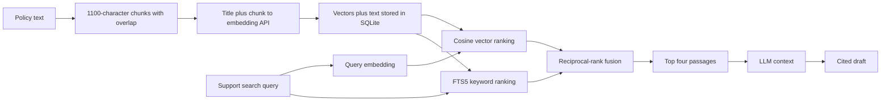

# Learn the project in small steps

Open this folder in VS Code: **File → Open Folder → ai-support-resolution-agent**. Install the suggested Python extension, then select `.venv/Scripts/python.exe` with **Python: Select Interpreter**. Use the integrated terminal and run `.\.venv\Scripts\python.exe run.py`. Stop any already-running Resolve server first if port 8010 is occupied. The supplied debug configuration also starts the app with F5.

The application has already been built. Work through one exercise at a time so you can explain it yourself. The exercises below do not need API credits; real model generation and real embedding indexing do.

## First exercise: follow one request

Logic first: the browser cannot read SQLite directly. It requests a URL from FastAPI. The endpoint calls the store, converts the result to JSON, and the browser turns the JSON into visible text.

1. Open `app/main.py` and find `list_tickets()`.
2. Open `app/store.py` and find `tickets()`.
3. Visit `http://127.0.0.1:8010/api/tickets` and compare its JSON fields with the SQL query.
4. In your own words, write three sentences describing browser → endpoint → SQL → JSON → UI. Do not copy the README.

When you can explain those three sentences, move to the next exercise.

## What each important function does

| Function | Purpose and reason |
|---|---|
| `Settings.load()` in `config.py` | Loads model settings and the ignored local credential. Central configuration keeps secrets out of source files. |
| `create_app()` in `main.py` | Connects the provider, knowledge base, store, agent engine, routes, and frontend. Tests can inject controlled substitutes. |
| `start_run()` in `main.py` | Creates a run and schedules the agent as a background task. HTTP 202 lets the browser poll instead of holding one long request. |
| `chunk_text()` in `retrieval.py` | Splits long policies into overlapping passages. Smaller passages fit the model context and allow precise citations. |
| `Provider.embed()` in `provider.py` | Sends text to the real OpenAI embedding API and returns numerical vectors. It maps provider failures to safe application errors. |
| `KnowledgeBase.index()` | Embeds each policy title plus passage, then persists the vector and searchable text. It skips documents already indexed with the same embedding model. |
| `cosine()` | Compares query and passage vector directions to rank semantic matches. It is not an answer-confidence calculation. |
| `reciprocal_rank_fusion()` | Adds a contribution of `1 / (60 + rank)` from each ranked list. It combines search orders without comparing incompatible raw scores. |
| `KnowledgeBase.search()` | Embeds the query for semantic search, runs FTS5 for keyword search, and returns the top passages in the selected mode. |
| `ResolutionEngine.build_agent()` | Gives one LLM three narrow tools and instructions. Tool scope limits what the model can actually do. |
| `lookup_customer()` | Reads the ticket's synthetic customer plan and role. It cannot choose another customer or modify an account. |
| `search_knowledge()` | Calls RAG and records the returned passages as evidence. At most four searches are allowed per run. |
| `record_resolution()` | The only write tool. The SDK pauses it for approval; after resume it checks and records the exact stored draft locally. |
| `validate_draft()` | Checks exact source quotes, missing citations, and required escalation categories. A valid quote does not prove that all reply claims follow from it. |
| `ResolutionEngine.execute()` | Runs the SDK loop, requires lookup and retrieval, validates the proposed draft, and stores the paused SDK state. |
| `ResolutionEngine.review()` | Loads server-owned state, checks the pending tool arguments, and either discards the draft or resumes the approved tool. |
| `Store.claim_review()` | Atomically changes `waiting_review` to `resuming`. A duplicate decision cannot claim the same pending run. |
| `Store.commit_resolution()` | Compares the write arguments with the reviewed draft and updates the ticket and run in one SQLite transaction. |
| `public_error()` | Distinguishes billing exhaustion, rate limits, authentication, network failure, and invalid agent behavior without leaking raw secrets. |
| `grade_case()` in `evals/grading.py` | Checks cited policy, expected disposition, tool use, valid quotes, and the approval boundary. This is a small behavior check, not a universal correctness score. |

## Second exercise: trace RAG

The text converted into vectors is **the policy title plus each chunk**. Later, **the search query** becomes a vector too. Customer records, approval decisions, and the final reply are not permanently embedded in this version.



Before reading the implementation, predict which document should match “How long can I download an export?” Then inspect the synthetic policies in `data/seed.json`. Run `tests/test_retrieval.py` to observe retrieval with a deliberately small test embedder. Test vectors are only testing tools; the application uses OpenAI embeddings.

Write your own small `top_ids()` function in a scratch file: accept a list of dictionaries containing `id` and `score`, sort by score descending, and return the first three IDs. Try ties, an empty list, and fewer than three entries. This teaches the ranking operation that RAG uses.

## Third exercise: explain approval

Prediction: if the LLM calls `record_resolution`, does the ticket immediately become resolved? Find the `needs_approval=True` decorator and the `waiting_review` state before answering.

The browser receives the draft, evidence, and trace. It never receives the serialized SDK snapshot. Its decision is simply `{"approve": true, "note": "Reviewed sources"}`. The backend loads its saved snapshot, confirms the exact pending arguments, claims the review, and resumes the tool. Rejection keeps the ticket open and avoids another model call.

Run `tests/test_agent.py` and inspect the test that recreates the store and engine before approval. Explain why approval must still work after that restart, and why a second approval returns a conflict.

## Fourth exercise: read FastAPI errors

Use the terminal to send a harmless invalid request:

```powershell
$body = @{ subject = 'no'; body = 'short' } | ConvertTo-Json
Invoke-WebRequest -Uri 'http://127.0.0.1:8010/api/tickets' -Method Post -ContentType 'application/json' -Headers @{ 'X-Resolve-Request' = '1' } -Body $body
```

Expect HTTP 422. The exception in PowerShell is expected: the request reached the app, but `TicketInput` rejected its fields. Compare that with HTTP 403 when the application header is absent, HTTP 404 for a missing ticket, HTTP 409 for a duplicate review, and HTTP 503 for an unavailable model service.

`X-Resolve-Request` is a local request boundary, not user authentication. Production would need authenticated reviewers and tenant authorization.

## Debugging checklist

- **Port already in use:** stop the earlier Resolve process in its terminal with Ctrl+C; then run once. Leave unrelated applications running.
- **Import not found:** confirm the selected interpreter is this folder's `.venv`, then run `setup.ps1` if dependencies are missing.
- **Index empty:** real indexing has not completed. Read the provider error rather than assuming retrieval is broken.
- **Credits exhausted:** the saved key exists, but API billing blocks requests. Waiting or replacing the key does not restore credits.
- **Invalid citation:** compare the draft quote against the retrieved passage and source ID. Do not weaken validation to make the test pass.
- **Review conflict:** the draft was already handled or is not ready. Reload the ticket and inspect its run status.

For errors, share the failing command, safe error message, and what you expected. Never share `.env.local` or a key.
